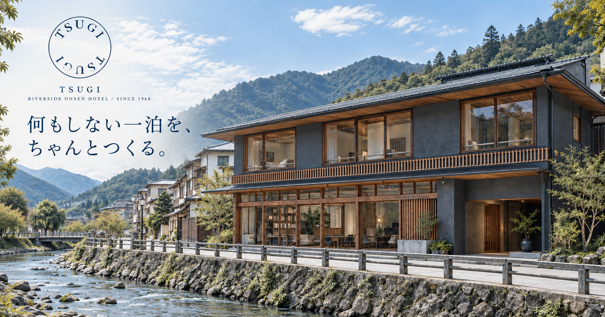

# TSUGI — 温泉宿のWebサイト

[公開サイトを見る](https://coconattsu0723.github.io/tsugi-onsen-hotel/)

## 概要

TSUGIは、1968年に建てられた旅館を12室から8室の宿へ改修した、架空の温泉宿です。古い柱や木製の建具、浴場の石を残し、客室を減らして生まれた空間の一部をラウンジにしたという設定で、宿の過ごし方と建物を受け継ぐ背景を伝えるサイトを制作しました。

## ページ構成

| ページ | 内容 |
| --- | --- |
| [TOP](index.html) | 宿のコンセプトと各ページへの案内 |
| [STAY](stay.html) | 客室・温泉・食事・ラウンジと宿泊案内 |
| [STORY](story.html) | 改修の方針と建物に残した素材 |
| [EXPERIENCE](experience.html) | 宿で過ごす一日と周辺の散策案内 |
| [RESERVATION](reservation.html) | 宿泊条件と予約者情報を入力し、内容を確認するデモ |

## 使用技術

HTML、CSS、JavaScriptで実装し、GitHub Pagesで公開しています。画面幅に合わせてレイアウトを調整し、写真にはAVIF・WebPのレスポンシブ画像を使用しています。予約フォームはブラウザ内で入力内容を確認するデモです。
