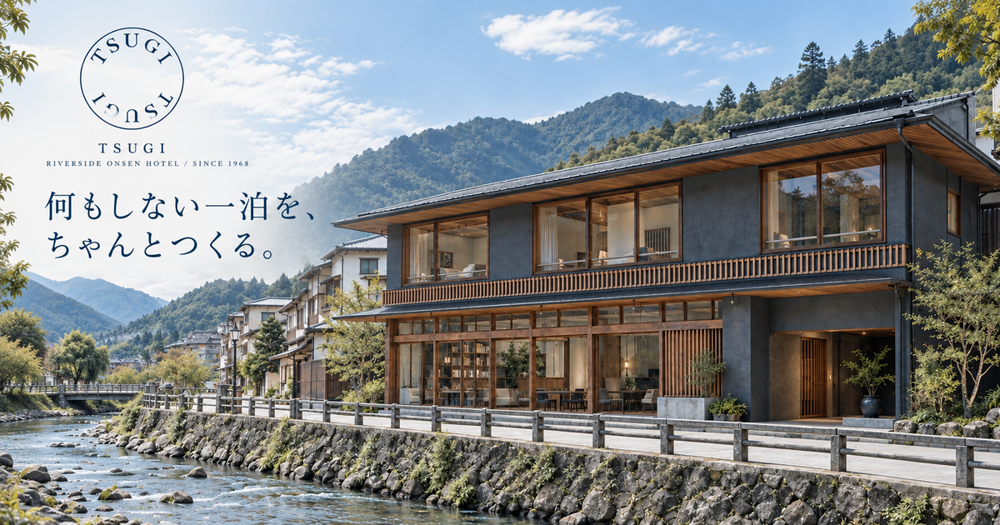

# TSUGI

> 山と川のあいだにある、8室の温泉宿。
>
> 「編集 × 余白」を軸に、企画・情報設計・ビジュアルデザインから実装、公開後QAまで一貫して制作した架空施設のマルチページWebサイトです。

## Project Summary

| 項目 | 内容 |
| --- | --- |
| Project | TSUGI |
| Category | 温泉宿 / Multi-page Website |
| Type | 自主制作 / 架空施設 |
| Period | 2026年9月（Git実装履歴：9月19日〜24日） |
| Pages | HOME / STAY / STORY / EXPERIENCE |
| Role | 企画、ターゲット設計、ブランドコンセプト、情報設計、コピー、ビジュアルデザイン、画像ディレクション、レスポンシブデザイン、実装、QA、公開 |
| Scope | Planning / IA / Copy / Visual Design / Responsive Design / HTML / CSS / Vanilla JavaScript / Accessibility / Image Optimization / Metadata / Git / GitHub Pages |
| Tech / Tools | HTML5、CSS3、Vanilla JavaScript、Pencil、Node.js、Sharp、Git、GitHub、GitHub Pages |
| Live Site | [coconattsu0723.github.io/tsugi-onsen-hotel](https://coconattsu0723.github.io/tsugi-onsen-hotel/) |
| Repository | [github.com/Coconattsu0723/tsugi-onsen-hotel](https://github.com/Coconattsu0723/tsugi-onsen-hotel) |

## Overview

TSUGIは、1968年頃に建てられた小規模旅館を改修し、12室あった客室を8室へ減らしたという設定の温泉宿です。減らした4室分を、売上のための客室ではなく、ラウンジ、共用空間、余白、静かな時間へ再編集しました。

施設名には、建物の記憶を「継ぐ」と、次の価値へ進む「次」の二つの意味を持たせています。この設定を紹介文だけで説明するのではなく、写真の大小、非対称な配置、大きな数字、余白のリズムによってサイト全体で体験できるよう設計しました。

## Background / Goal

これまで制作してきた1ページ完結型のLPとは異なり、今回は4ページを持つ小規模サイトとして制作しました。目的は、見た目を整えるだけでなく、以下の設計・実装力を一つの作品で示すことです。

- 施設情報を役割別に分ける情報設計
- ページを横断するGlobal Navigationと共通コンポーネント
- 各ページの目的に合わせた異なる情報の見せ方
- 375pxから1440pxまでのレスポンシブ再構成
- キーボード操作やARIAを含むアクセシビリティ
- 画像配信、Metadata、GitHub Pages公開までを含む実運用に近い仕上げ

静かな宿の空気感と、予約・客室情報を迷わず読める操作性の両立を制作上の目標としました。

## Target

主なターゲットは20代後半〜40代です。建築、インテリア、空間設計、素材に関心があり、観光地を効率よく巡る旅よりも、静かな小規模宿でゆっくり過ごすことに価値を感じる層を想定しました。

一般的な「高級和風旅館」の記号に寄せるのではなく、Modern / Quiet / Architectural / Editorialを重視しています。価格の高さを装飾で訴求するよりも、建物の背景、素材、滞在時間の質が伝わる表現のほうがターゲットの価値観に合うと判断しました。

## Concept

### Brand Concept：編集 × 余白

既存の建物をすべて新しくするのではなく、残すものを選び、減らした空間に新しい価値を与える考え方です。ブランドの価値を次の3段階に整理しました。

1. **EDIT** — 残すもの、変えるもの、なくすものを選ぶ
2. **SPACE** — 12室を8室にし、空間の密度を下げる
3. **TIME** — 生まれた余白が、滞在者の静かな時間になる

### Design Direction

**Experimental Editorial × Modern Architecture × Japanese Materiality**

Quiet / Modern / Architectural / Editorial / Material / Minimal / Slightly Experimentalをキーワードに、雑誌のような強弱と建築図面のような秩序を組み合わせました。

一方で、筆文字、和柄、金色、温泉マーク、過度な高級旅館表現は使用していません。日本らしさは装飾記号ではなく、木、石、光、影、余白、抑制した色によって表現しました。

## Information Architecture

情報を1ページに詰め込まず、ユーザーの関心とページの役割に合わせて4ページへ分けました。

| Page | Role | 主な内容 |
| --- | --- | --- |
| HOME | 施設全体の入口 | コンセプトを短時間で伝え、STAY / STORY / EXPERIENCEへ誘導 |
| STAY | 宿泊判断に必要な情報 | 客室、温泉、食事、ラウンジ、宿泊情報、FAQ |
| STORY | ブランドの背景を伝える | 建物の歴史、KEEP / CHANGE / REMOVE、12室から8室への編集思想 |
| EXPERIENCE | 滞在を具体的に想像させる | 一日の過ごし方、徒歩で巡る周辺体験、地図、アクセス |

ページ分割によって、HOMEには全体像と感情的な入口、STAYには比較・確認できる実用情報、STORYには読み進める物語性、EXPERIENCEには時間と場所の流れを持たせました。Global Navigation、Footer、関連ページ導線を共通化し、別ページへ移動しても現在地と次の選択肢が分かる構成にしています。

## Design System

### Color

| Token | Hex | Role |
| --- | --- | --- |
| Bone | `#F1EFE8` | サイト全体の基調背景。白よりも素材感のある明るさをつくる |
| Surface | `#E9E6DD` | セクションや情報面の切り替え |
| Ink | `#1D1E20` | 本文・見出しの基本色 |
| Navy | `#172129` | Header、Menu、Footer、強いCTAなどのブランドカラー |
| Stone | `#6F6A63` | 補助テキスト、Meta情報 |
| Muted | `#A9A49B` | 優先度の低いラベルや補助表現 |
| Line | `#C5BFB4` | 区切り線、構造を示す細線 |
| Rust | `#A45A3A` | 番号、アクセント、Focus Ring |
| Footer Line | `#4C5860` | Navy背景上の区切り線 |

明るい面ではBoneとInk、暗い面ではNavyと白を中心にし、Rustは注目点だけに限定しました。色数を抑えることで、写真に含まれる木、石、緑の色を主役にしています。

### Typography

- **Noto Sans JP**：Navigation、UI、Label、CTA、仕様、数字など、機能と構造を伝える要素
- **Noto Serif JP**：STORY、思想、余韻を持たせたいNarrative Copy

Sans Serifは情報を素早く読み取れる機能性、Serifは建物の時間や物語を感じさせる編集性を担います。二つの書体を装飾として混在させず、情報の役割によって使い分けました。

### Layout / Image

- Mobile Firstを基準に、4-columnから画面幅に応じて構成を拡張
- 左右対称に揃えすぎず、見出し、本文、写真のAxisを意図的にずらす
- Full Bleed、縦長、横長、Detail Cutを混ぜ、写真の密度に強弱をつける
- 写真には角丸やドロップシャドウを付けず、建築素材そのものを見せる
- Cardを均等に並べるだけではなく、内容の役割に応じてレイアウトを変える

## Page Design

### HOME

HOMEは、施設の全体像を短いスクロール単位で理解し、各詳細ページへ移動できる入口として設計しました。

1. **Hero** — 建物と川を同時に見せる写真に「何もしない一泊を、ちゃんとつくる。」を重ね、滞在価値を最初に提示
2. **Introduction** — 「残すものを選ぶ。」からEDIT / SPACE / TIMEへコンセプトを展開
3. **STAY Preview** — 客室と館内体験を写真と要点で紹介
4. **12 → 08** — 客室数を減らした事実を大型Graphic Typographyで象徴化
5. **Lounge** — 減らした空間が居場所へ変わったことを説明
6. **STORY** — 建物の記憶と編集思想へ誘導
7. **EXPERIENCE** — 滞在中の時間の使い方へ誘導
8. **LOCATION** — 川沿いの温泉町と徒歩圏の魅力を紹介
9. **Final CTA** — Navyの面でページを締め、予約導線の位置を明確化

特に「12 → 08」は、説明文より先に変化の大きさを視覚で理解できるよう、数字を一つのGraphicとして扱いました。余白を増やした施設の判断を、Web上でも要素を詰め込みすぎない構成として反映しています。

### STAY

STAYは、宿泊を検討する人が必要な情報を比較・確認できる実用ページです。

- **Rooms** — Garden / River / Cornerの3タイプとDetail写真、定員・広さ・設備を整理
- **Bath** — 主写真とDetail写真で、空間全体と素材感の両方を提示
- **Dining** — DinnerとBreakfastを時間の違いが伝わる写真で構成
- **Lounge** — 客室以外にも滞在できる場所があることを紹介
- **Stay Information** — Check-in / Check-outなどの実用情報を一覧化
- **FAQ** — 6項目をAccordionで必要な情報だけ開ける構成に整理

Room Cardは画面幅に応じて形を変えています。SPでは1列で写真と情報を縦に読み、768pxと1024pxでは一覧は1列のままCard内部を横長に再構成、1366px以上では3列に展開します。同じ情報を保持しながら、各幅で写真の見やすさと比較しやすさを調整しました。

### STORY

STORYはサイト内で最もEditorial性を高くし、施設の思想を読むだけでなく、スクロールのリズムとして体験できるページにしました。

- **1968** — 建物の起点
- **THE EDIT** — 改修の基本姿勢
- **KEEP / CHANGE / REMOVE** — 判断の3分類
- **12 → 08** — 数を減らすことで生まれた価値
- **MATERIALS** — 柱、梁、木製建具、庭、階段などの素材と記憶
- **NEXT NOT NEW** — 「新しくする」より「次へつなぐ」という結論

KEEP / CHANGE / REMOVEは、同じ書式の説明Cardにはせず、文字サイズ、写真比率、配置、背景色、余白を変えて構成しました。特にMATERIALSは複数写真とテキストのAxisを組み合わせ、建物を部分から読み解く誌面のようなレイアウトにしています。

### EXPERIENCE

EXPERIENCEは、施設の設備説明ではなく「そこで一日をどう過ごすか」を具体化するページです。

- **Hero** — 朝の散歩写真と「一日を、急がない。」で過ごし方を提示
- **A DAY AT TSUGI / Timeline** — ARRIVEからBREAKFASTまで7つの時間を順に紹介
- **Around** — Public Bath / Coffee / Bakery / Shrineを徒歩体験として紹介
- **Map / Legend** — 宿、川、店、神社の位置と歩行時間を対応させる
- **Closing** — 予定を埋めない滞在価値を再提示

Timelineは情報の順序を変えず、SPでは1列と短いConnector、768px・1024pxでは1列と連続したVertical Axis、1366px以上ではCentral Axisを中心に左右へ振るZigzagへ変化させました。Scene Noteは余裕のある768pxとDesktopで表示し、1024pxでは混雑を避けるため非表示にしています。

## Responsive Design

375 / 390 / 768 / 1024 / 1366 / 1440pxを確認幅とし、Mobile Firstで実装しました。小さい画面を単純に拡大するのではなく、情報Hierarchyを保ちながらBreakpointごとに構成を再設計しています。

### 1. Header / Navigation

- **1024px以下**：Logo、Reservation表示、Hamburgerを配置。MenuはFull-screen Navy Overlay
- **1366px以上**：Logo、Global Navigation、ReservationをHeader内へ展開

狭い画面ではNavigation項目を隠すだけでなく、Overlay内に主要ページ、Access、FAQをまとめ、移動先を一覧できる構成にしました。

### 2. Room Card

- **SP**：1列、写真から仕様へ縦に読む
- **768 / 1024px**：一覧は1列、Card内部を写真＋情報の横組みに変更
- **1366px以上**：3列で客室タイプを比較

### 3. EXPERIENCE Timeline

- **SP**：1列＋短いConnector
- **768 / 1024px**：1列＋Vertical Axis
- **1366px以上**：Central Axis＋Zigzag＋Scene Note

### 4. Dining

SPではDinnerとBreakfastを順に読む構成、Tablet以降では写真と説明の幅、位置関係を変え、2つの時間帯を比較できる画面密度に調整しました。

### 5. STORY / MATERIALS

SPでは写真と本文を安全に縦積みし、中間幅では横方向の関係を追加、Desktopでは複数写真の配置と余白を広げています。Pencilの数値をそのまま縮小するのではなく、特に768px・1024pxで文字と写真が衝突しないよう個別に調整しました。

## Implementation

### HTML

`header`、`nav`、`main`、`section`、`footer`などのSemantic HTMLを使用し、各ページの見出し構造を整理しました。4ページすべてに一つの`h1`を置き、ページ内Anchorと関連ページLinkを用途別に設定しています。

### CSS

CSSは役割別に分割しました。

- `foundation.css` — Color、Typography、Spacing、基本要素
- `layout.css` — Container、Header、Footerなどの大枠
- `components.css` — Button、Section Label、Room Card、FAQなどの共通部品
- `pages.css` — HOME / STAY / STORY / EXPERIENCE固有の構成とBreakpoint調整

色、余白、Header高などをCustom Propertiesで管理し、共通ルールとページ固有ルールを分離しました。共通Componentを使いながら、各ページの内容まで同じCard表現に揃えないことも意識しています。

### Vanilla JavaScript

外部UIライブラリを使わず、Responsive MenuとFAQ Accordionを実装しました。

**Responsive Menu**

- `aria-expanded`と`aria-hidden`の同期
- EscapeキーでClose
- Tab / Shift+TabのFocus Trap
- Close後にMenu ButtonへFocus Return
- Open中のBody Scroll Lock
- Navigation Link選択時のClose
- Desktop幅へのResize時に状態をReset

**FAQ Accordion**

- Native ButtonによるKeyboard操作
- `aria-expanded`と`aria-controls`の対応
- 回答領域の`hidden`切り替え
- 複数項目を同時にOpen可能

## Accessibility

実装時に、見た目と同時に操作・理解のしやすさを確認しました。

- 4ページすべてで`h1`を一つにし、見出し階層を整理
- Keyboard利用者向けのSkip Linkを設置
- Global Navigationで現在ページに`aria-current="page"`を設定
- Overlay MenuにARIA状態、Escape、Focus Trap、Focus Returnを実装
- FAQにNative Button、`aria-expanded`、`aria-controls`を実装
- Rustの2px Focus Ringで`:focus-visible`を可視化
- 内容を持つ写真にAlt Text、装飾画像に空の`alt`を設定
- Mapだけに情報を閉じず、番号・名称・徒歩時間をLegendにも記載
- 架空の予約LinkはFocus対象にせず、Linkとして誤認させない非Interactive要素へ変更

## Performance

写真が体験の中心になる一方、元画像をそのまま配信すると転送量が大きくなるため、原本を保持したままWeb配信用画像を別管理しました。

### Responsive Image

- 実際に使用する正式画像25点を対象に最適化
- `assets/images/optimized/`へAVIF 89点、WebP 89点を生成
- 表示幅に合わせ、480 / 768 / 1024 / 1122 / 1366 / 1448 / 1536 / 1600pxから画像ごとに必要な幅だけを生成
- `<picture>`、`srcset`、`sizes`でLayoutに合うSourceを選択
- Original PNGをFallbackとして維持
- 4ページ合計48個の`picture`要素を使用
- 各ページのHero 1点は`fetchpriority="high"`とEager Loading
- Foldより下の44画像は`loading="lazy"`と`decoding="async"`
- `width` / `height`属性で画像領域を事前確保

画像内に文字を含むMapは写真より高いQualityで書き出し、店名、番号、River Labelの可読性を優先しました。変換はNode.js / Sharpの再実行可能なScriptにまとめ、原本を上書きしない設計にしています。

### Representative File Size

以下は、原本PNGと最大表示付近の生成Variantを比較した実測値です。単一画像の比較であり、ページ全体の転送量やLighthouse Scoreを示すものではありません。

| Image | Original PNG | AVIF | Reduction | WebP | Reduction |
| --- | ---: | ---: | ---: | ---: | ---: |
| HOME Hero（1600w） | 2,897,110 B | 174,454 B | 94.0% | 318,124 B | 89.0% |
| Bath Main（1536w） | 3,116,757 B | 167,962 B | 94.6% | 299,118 B | 90.4% |
| Dinner（1536w） | 2,160,905 B | 90,771 B | 95.8% | 140,396 B | 93.5% |
| Map（1536w） | 3,236,668 B | 377,415 B | 88.3% | 617,120 B | 80.9% |

## Metadata / SEO

4ページごとに内容に合わせたMetadataを設定しました。

- Page固有の`title`と`description`
- 公開URLに対応したCanonical URL
- Open Graph：Title、Description、URL、Site Name、Locale、Image
- Twitter Card：`summary_large_image`、Title、Description、Image
- 1200 × 630pxの正式OGP Image
- 32px / 48px PNG、ICOのFavicon
- 180px Apple Touch Icon
- `<html lang="ja">`

Visible HeadingとMetadataを分けて設計し、検索結果・SNS共有・Browser Tabの各文脈で内容が分かるようにしました。

## Git / Deployment

### Git Workflow

変更範囲を確認しやすくし、問題が起きたときに工程単位で追跡できるよう、Commitを次の段階に分けました。

1. Initial Project / Foundation / Global Layout
2. HOME
3. STAY
4. STORY
5. EXPERIENCE
6. Breakpoint別Responsive LayoutとVisual Correction
7. FAQ Accessibility
8. Final Visual Alignment
9. Image Optimization
10. Metadata / Favicon / OGP
11. Production Metadata
12. 公開後のReservation Link修正

ページ単位と目的単位でCommitを分けることで、デザイン実装、レスポンシブ修正、パフォーマンス対応、公開後修正を混在させずに管理しました。

### Deployment / Public QA

GitHubの`main` branchをSourceとしてGitHub Pagesへ公開しました。公開環境でHOME / STAY / STORY / EXPERIENCEを375 / 390 / 768 / 1024 / 1366 / 1440pxの6幅、合計24ケースで再確認しています。

確認結果：

- Document、CSS、JavaScript、画像、Logo、Favicon、OGP Asset：HTTP 200
- 24ケースすべてで横方向Overflowなし
- Broken Image、Console Error、Page Error、Failed Request：0件
- Global Menu：Keyboard Open、Escape Close、Focus Returnを確認
- FAQ：Keyboard OpenとARIA状態更新を確認
- `experience.html#access`、`stay.html#faq`：対象Sectionへの移動を確認
- Canonical、`og:url`、OGP / Twitter Image：公開URLと一致
- Internal Linkと公開Assetの404：0件

### Reservation Link

架空施設のため正式な外部予約URLは存在しません。公開前の仮Link `reservation.html`を残すと404になるため、公開サイトではReservation表示を非InteractiveなPlaceholderへ変更しました。

空Linkや架空URLを設定せず、Visual Designは維持したまま、Tab Focus、`role="link"`、Pointer Cursorを除いています。これは未完成な導線を隠すのではなく、存在しないサービスURLを捏造しないための実装判断です。

## Challenges & Solutions

### Challenge 1：SPからDesktopまでEditorial Layoutを保つ

**Problem**

写真と余白に強弱をつけた構成は、単純な拡大・縮小では中間幅でバランスが崩れやすい状態でした。

**Decision**

要素の情報順序は維持しつつ、Breakpointごとに写真比率、Text幅、Axis、並び方を再設計しました。

**Implementation**

375 / 390 / 768 / 1024 / 1366 / 1440pxの正式Frameと実Browserを比較し、Mobile FirstのMedia Queryへ段階的にルールを追加しました。

**Result**

24ケースすべてで横方向Overflowと画像破損を出さず、SPの読みやすさとDesktopの誌面性を両立できました。

### Challenge 2：STORYの複雑なImage Composition

**Problem**

KEEP / CHANGE / REMOVEとMATERIALSは、写真の大小とText位置が意味を持つため、等幅Cardにすると編集思想が弱くなります。一方で、中間幅では写真と文字が衝突しやすくなりました。

**Decision**

全幅で同じ構図を縮小せず、SPは安全な縦積み、Tabletは関係性が伝わる横構成、Desktopは余白を含む複数写真のCompositionへ切り替えました。

**Implementation**

STORY専用のBreakpoint Ruleを設け、768pxのVisual Correction、1024pxの中間Layout、1366px以上のDesktop Compositionを別々に調整しました。

**Result**

建物の細部を「読む」Editorial性を保ちながら、各幅で見出し・本文・写真の重なりを防ぎました。

### Challenge 3：同じTimeline情報を画面幅ごとに最適化する

**Problem**

Desktopの左右交互TimelineをそのままSPへ縮めると、時刻と本文の視線移動が増え、順序が分かりにくくなります。

**Decision**

情報と時系列は変えず、軸とCardの配置だけを画面幅に合わせて変える方針にしました。

**Implementation**

SPは短いConnector、768 / 1024pxは一つのVertical Axis、1366px以上はCentral AxisとZigzagを使用しました。1024pxではScene Noteを非表示にし、情報密度を調整しています。

**Result**

すべての幅でARRIVEからBREAKFASTまで同じ順序を保ちつつ、Desktopでは空間を活かした体験的な見せ方を実現しました。

### Challenge 4：Pencilと実Browserの差分を詰める

**Problem**

設計値が合っていても、日本語の改行、Font Rendering、画像Crop、Browser上の連続したSection Rhythmには視覚差が残りました。

**Decision**

数値確認だけで完了とせず、各ページ・各幅を実Browserで比較するVisual Auditを工程に組み込みました。

**Implementation**

ページ実装後にVisual Correction用Commitを分け、特に768 / 1024 / 1440pxのText幅、Section間隔、Image Positionを調整しました。最後に4ページを横断してRegressionを確認しました。

**Result**

正式デザインのHierarchyとRhythmを維持しながら、実際のBrowser Renderingに合わせたレイアウトへ仕上げられました。

### Challenge 5：写真の質と配信量を両立する

**Problem**

建築・木・石・湯気などの質感を見せる高解像度PNGは、サイト全体の印象に重要ですが、そのままでは配信量が大きくなります。

**Decision**

原本は保存し、使用場所と最大表示幅に合わせたAVIF / WebP Variantを別生成する方針にしました。

**Implementation**

画像ごとに必要なWidthを定義し、`picture`、`srcset`、`sizes`、Lazy Loading、Hero Priorityを設定しました。文字を含むMapは写真より高いQualityにしています。

**Result**

CropとDesignを変えず、代表画像ではAVIFで88.3〜95.8%、WebPで80.9〜93.5%のFile Size削減を確認しました。

## AI-assisted Workflow

AIは完成物を一括生成する手段ではなく、制作工程を確認・改善する支援ツールとして使用しました。

- **Design Review** — Pencilと実Browserの差分抽出、Hierarchy・Spacing・改行の確認補助
- **Implementation Review** — HTML構造、CSS Breakpoint、Component再利用の確認補助
- **Responsive QA** — 6幅×4ページのOverflow、画像、Interaction、Metadata確認
- **Image Production Support** — 施設世界観に合う画像制作の支援と、正式Assetの整理・用途管理
- **Code Verification** — Menu、FAQ、Responsive Image、公開Path、404の検証補助

ブランド設定、情報の優先順位、写真の採用、レイアウト変更、Visual判断、最終的な採否は制作者が決定しました。AIから得た提案もそのまま採用せず、正式Pencil、実装コード、実Browserの3点を照合して判断しています。

## What I Learned

1. **Multi-page IA**

   情報量を増やすだけでなく、ページごとに「俯瞰・比較・物語・体験」という役割を与えることで、ユーザーの目的に沿った導線をつくれると学びました。

2. **Responsive Design**

   レスポンシブは縮小率の調整ではなく、同じHierarchyを保ったまま情報の並べ方を再編集する作業だと理解しました。

3. **Component Design**

   Header、Footer、Button、Label、FAQなどは共通化しつつ、内容まで一律のCardにしないことが、保守性とページ固有の表現を両立させます。

4. **Editorial Layout**

   写真サイズ、改行、余白、Axisのずれを意図的に設計すると、装飾を増やさなくても物語の強弱をつくれます。

5. **Accessibility**

   ARIA属性だけでなく、Focusの移動、Escape、Linkの実在性、Map情報の代替表現まで含めて操作の流れを確認する必要があります。

6. **Performance / Git Workflow**
   画像最適化やMetadataは最後の付加作業ではなく公開品質の一部です。また、工程を目的別にCommitすることで、Visual CorrectionやProduction Fixの理由を後から説明しやすくなりました。

## Links

- [Live Site](https://coconattsu0723.github.io/tsugi-onsen-hotel/)
- [GitHub Repository](https://github.com/Coconattsu0723/tsugi-onsen-hotel)
